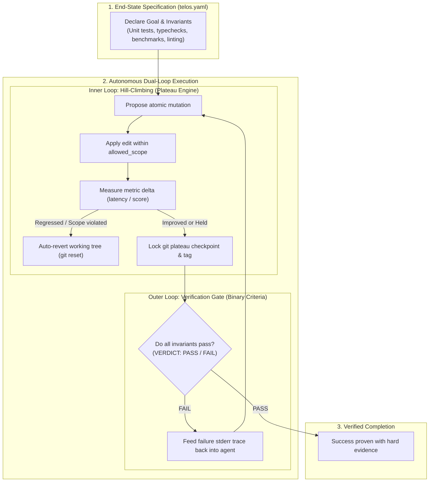

# Telos (τέλος)

[](https://github.com/vamshidharre/telos/actions)
[](https://opensource.org/licenses/MIT)
[](https://www.python.org/downloads/)

> **τέλος (telos)**: *Greek for "end", "purpose", or "goal".*  
> An autonomous engineering runtime for AI coding agents based on **End-State Invariant Specification** and **Dual-Loop Plateau Ascent**.

---

## The Origin & Philosophy

At the **Claude Founder House**, founding engineers and leaders from Anthropic shared a core paradigm shift for frontier models:

> *"Treat a lot of things as temporary in such a fast-moving space with Frontier LLMs constantly improving, changing and evolving. **'Unlearning'** has become a new buzzword in the AI community. Forget old workflows and 'what used to work', adapt and change to the new normals.*  
> 
> *Your attention is the bottleneck: when working with agents everything is a loop. The more you're involved in that loop the more of a bottleneck you become.*  
> 
> *She talked about 2 main types of loops:*  
> *1: **Verification loop** - does this meet my criteria yes/no. If no keep iterating.*  
> *2: **Hill climbing loop** - What small step can be improved on in this iteration, to get to the next plateau, then what small step can be improved next to get to the plateau after that, and so on until we reach the top of the hill.*  
> 
> *On top of that avoid over describing what you want in your prompts and instead **focus only on the end state or goal in your prompting**, and along with your verification loops let the model get there by itself."*  
> — **Daisy Hollman**, Anthropic

---

## Why Telos?

Traditional agentic workflows suffer from two fundamental problems:
1. **Procedural Prompt Bloat:** Dictating 20 micro-steps in prompt instructions degrades frontier model reasoning and breaks whenever the codebase changes.
2. **The Attention Bottleneck:** Demanding human approval for every small experiment or trial slows down engineering velocity to human speed.

**Telos replaces procedural hand-holding with objective end-state gates:**
- You define **what success looks like** (`telos.yaml`) — invariants, acceptance criteria, and objective metrics.
- The model explores paths autonomously inside **two complementary loops**:
  - **Outer Loop (The Verifier):** Binary gatekeeper (PASS/FAIL).
  - **Inner Loop (The Hill-Climber):** Step-wise ascent locking plateaus via Git commits/tags and auto-reverting regressions.

---

## Architecture



---

## Installation

### Python CLI
```bash
pip install telos-agent
# Or install locally in editable mode:
git clone https://github.com/vamshidharre/telos.git
cd telos
pip install -e .
```

### As an Agent Skill (Claude / Antigravity / Cursor)
```bash
npx skills add vamshidharre/telos --skill telos --agent antigravity --yes
```

---

## Quickstart

### 1. Initialize Contract
Generate a starter `telos.yaml`:
```bash
telos init
```

Example `telos.yaml`:
```yaml
goal: "Refactor calculation engine to O(N) and reduce benchmark time below 10ms"

# Outer Loop: Acceptance invariants that must NEVER fail
invariants:
  - "pytest tests/"
  - "ruff check src/"

# Inner Loop: Hill-climbing objective metric
metric:
  command: "python benchmark.py"
  direction: "minimize"
  target: 0.01

allowed_scope:
  - "src/**"
  - "tests/**"

budget:
  max_cycles: 10
  timeout_sec: 60
```

### 2. Run Outer Verification Gate
Check whether the current repository state passes all acceptance invariants:
```bash
telos check
```
Returns `VERDICT: PASS` (exit code 0) or `VERDICT: FAIL` with a structured diagnostic trace (exit code 1).

### 3. Step & Climb Plateaus
Execute an exploratory mutation and let Telos evaluate progress:
```bash
telos climb -m "memoize intermediate recursive states"
```
- If invariants pass and the metric improves: locks **Plateau #1** and creates Git tag `telos-plateau-1`.
- If an invariant fails or the metric regresses: automatically reverts your working tree via `git reset --hard` to the last good plateau!

### 4. Rollback
Manually restore to the last confirmed plateau at any time:
```bash
telos rollback
```

### 5. Inspect Status & History
```bash
telos status
telos history
```

---

## The 5 Invariants of Telos

1. **End-State Over Procedure**: Focus entirely on the destination. Never dictate line-by-line procedural steps if an invariant or test can verify it.
2. **Binary Verification Gate**: Verification is strictly boolean. Output is either `VERDICT: PASS` or `VERDICT: FAIL` with concrete stdout/stderr diagnostic traces. Self-review or prose assurances are never accepted as proof.
3. **Plateau-to-Plateau Ascent**: Break non-trivial goals into atomic, measurable gradients. Each improvement is locked as a git-backed plateau (`telos-plateau-<n>`).
4. **Zero-Cost Rollback on Regression**: If an exploratory step breaks an invariant or regresses the objective metric, the runtime immediately reverts the working tree to the latest confirmed plateau.
5. **Fail-Closed Truthfulness**: Never claim completion without a fresh passing run of all invariants after the last mutation.

---

## License

MIT License. Copyright (c) 2026 Vamshidhar Reddy.
